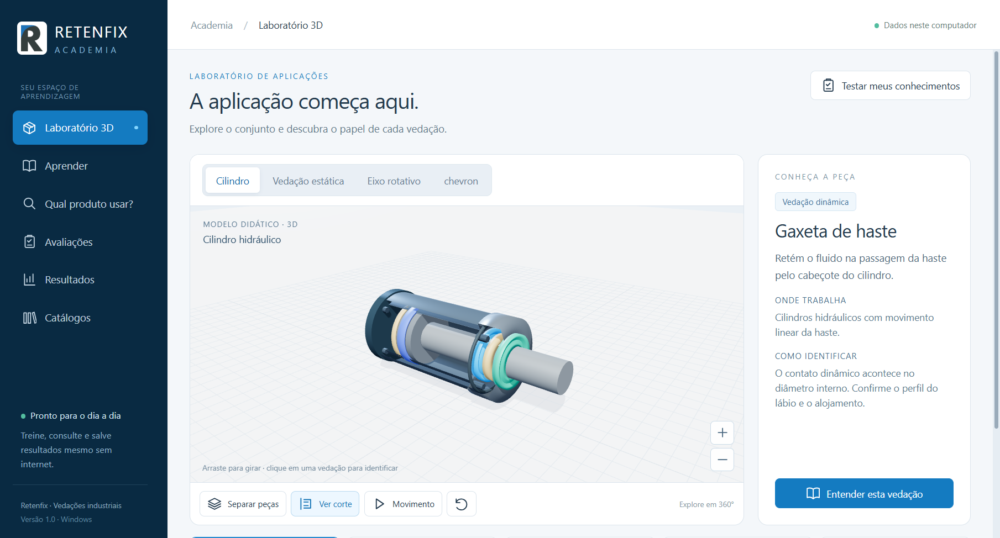
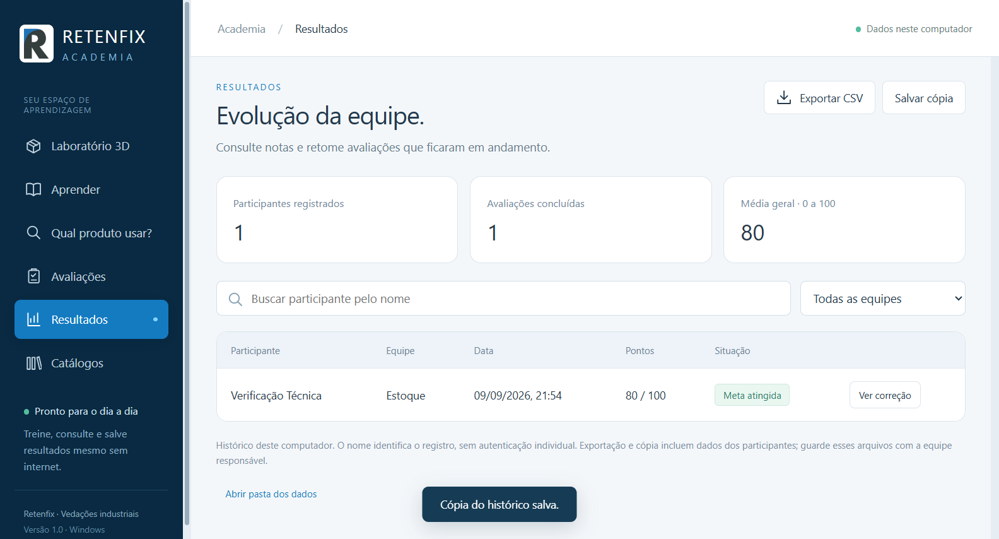
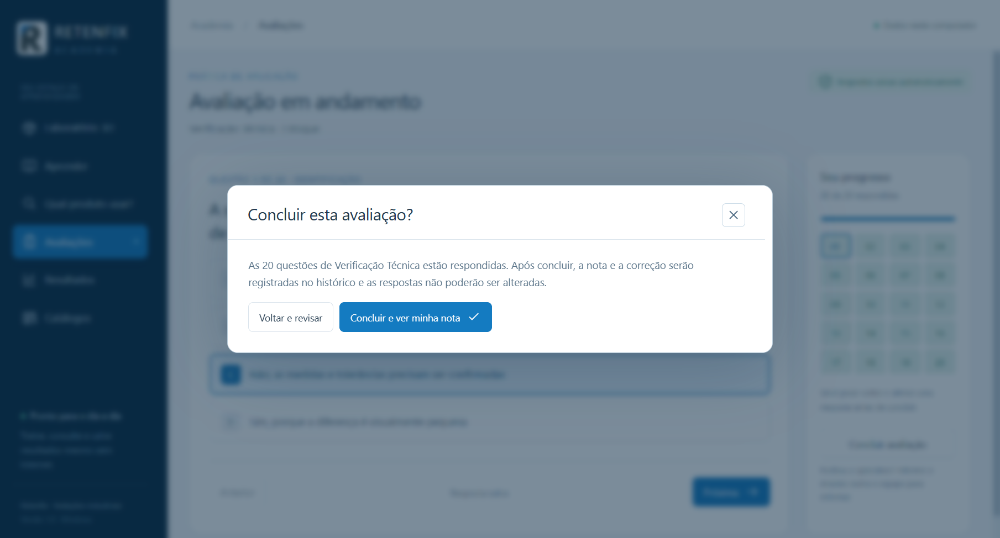

# Retenfix Academia

A Windows desktop training app for sales and inventory teams working with sealing components. It combines short technical lessons, product lookup, an interactive 3D lab, source references, and assessments with local results history.

> **Release status:** portfolio project under development and not publicly launched. The source snapshot is available for review; there is no public installer yet. Retenfix, AGEL, and other referenced names belong to their respective owners.

## What it does

- Teaches sealing fundamentals, product families, identification, and installation through short learning modules.
- Lets users search products, explore an interactive 3D model, and open locally downloaded technical catalogs.
- Assesses sales or inventory knowledge with 20 randomly selected questions from a 60-question bank, commented answers, and a score from 0 to 100.
- Keeps participant history locally and provides team averages, filters, CSV export, and JSON backup.

## Technology

- **JavaScript (CommonJS)** for the Electron main process, secure preload bridge, business rules, local storage, and tests.
- **HTML and CSS** for the desktop interface.
- **Three.js** for interactive 3D visualization.
- **SQLite** through Node.js `node:sqlite` in the Electron runtime.
- **Electron** for the Windows desktop application and packaging.

The app uses a local-first design: assessment results stay on the computer, with no required account or server. Security measures include `contextIsolation`, sandboxing, origin validation, and restricted browser permissions.

## Screenshots







These are screenshots of the application running.

## Run locally

Requirements: Node.js 20 or newer; Windows is required to run the Electron app.

```powershell
npm install
npm run catalogs:fetch
npm start
```

Run the automated tests with `npm test`. Build the Windows installer and portable package with `npm run dist:win`; the output is written to `release/`.

The catalog fetch script downloads materials from the official URLs listed in `src/data/sources.json`. The documents themselves are excluded from this repository. Check `NOTICE.md` before distributing any build that includes them.

## Privacy and license

Participant names and assessment results are stored on the local computer. CSV exports and JSON backups contain those records and should be handled as internal team data.

The source is marked **UNLICENSED**. It is published for portfolio review; no permission to copy, redistribute, resell, or use it commercially is granted. See `NOTICE.md` and `THIRD_PARTY_NOTICES.md` for third-party names, materials, and dependencies.

---

# Retenfix Academia (Português)

Aplicativo desktop para Windows voltado ao treinamento técnico de equipes de vendas e estoque que trabalham com componentes de vedação. Reúne aulas curtas, consulta de produtos, laboratório 3D interativo, fontes técnicas e avaliações com histórico local.

> **Status:** projeto de portfólio em desenvolvimento, ainda não lançado publicamente. O código está disponível para avaliação; o instalador ainda não foi publicado. Retenfix, AGEL e demais nomes citados pertencem aos respectivos titulares.

## Funcionalidades

- Ensina fundamentos de vedação, famílias de produtos, identificação e montagem em módulos curtos.
- Permite pesquisar produtos, explorar um modelo 3D e abrir catálogos técnicos baixados localmente.
- Avalia conhecimentos de vendas ou estoque com 20 questões sorteadas de um banco de 60, correção comentada e nota de 0 a 100.
- Mantém histórico local por participante, média da equipe, filtros, exportação CSV e backup em JSON.

## Tecnologias

- **JavaScript (CommonJS)** no processo principal do Electron, na ponte segura com a interface, nas regras do produto, no armazenamento local e nos testes.
- **HTML e CSS** na interface desktop.
- **Three.js** para a visualização 3D interativa.
- **SQLite** por meio de `node:sqlite` no runtime do Electron.
- **Electron** para o aplicativo desktop e a geração de pacotes para Windows.

A arquitetura é local-first: os resultados ficam no computador, sem exigir conta ou servidor. O projeto também aplica isolamento de contexto, sandbox, validação de origem e restrição de permissões do navegador.

## Executar localmente

Requisitos: Node.js 20 ou superior; Windows para abrir o aplicativo Electron.

```powershell
npm install
npm run catalogs:fetch
npm start
```

Execute os testes com `npm test`. Gere o instalador e a versão portátil para Windows com `npm run dist:win`; os arquivos são criados em `release/`.

O script de catálogos baixa materiais pelas URLs oficiais registradas em `src/data/sources.json`. Os documentos não estão incluídos neste repositório. Consulte `NOTICE.md` antes de distribuir uma versão que os contenha.

## Privacidade e licença

Nomes e resultados dos participantes são armazenados localmente. As exportações CSV e os backups JSON contêm esses dados e devem ser tratados como informações internas da equipe.

O código está marcado como **UNLICENSED** e é publicado para avaliação de portfólio. Isso não concede autorização para copiar, redistribuir, revender ou usar comercialmente. Consulte `NOTICE.md` e `THIRD_PARTY_NOTICES.md` para informações sobre marcas, materiais e dependências de terceiros.
